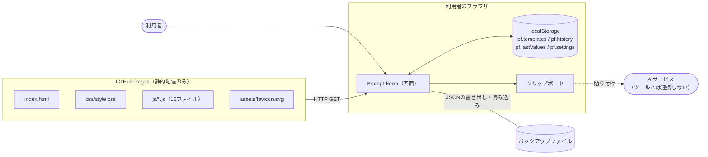
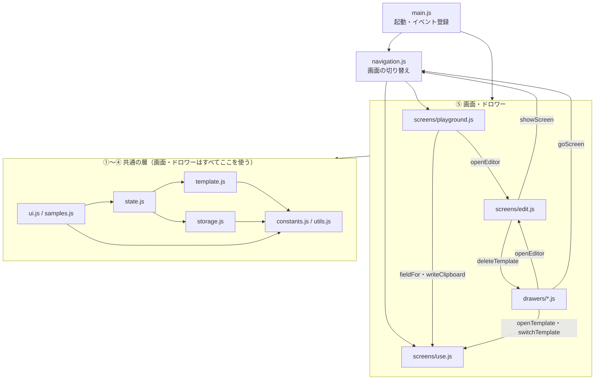
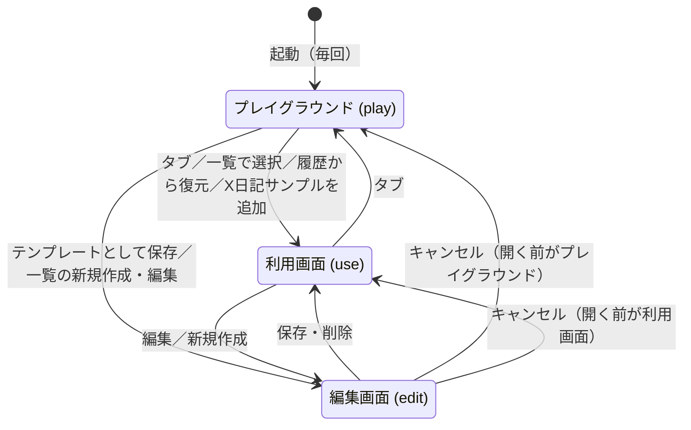
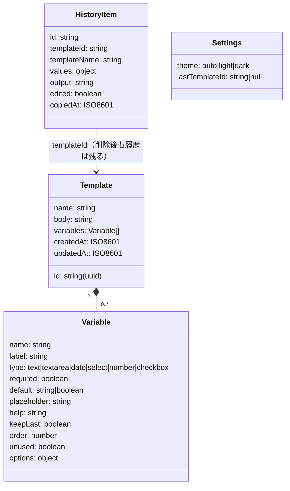

# 可変プロンプトフォーム 基本設計書

作成日：2026-10-12
対象コード：`main` ブランチ（HTML・CSS・JavaScript分割後）

## 0. この文書について

### 0.1 文書の関係

| 文書 | 内容 | 読む場面 |
| --- | --- | --- |
| [`rrd.md`](rrd.md) | 要件定義書。**何を**作るか（機能ID `F-xx` を定義） | 仕様を確認するとき |
| `basic-design.md`（この文書） | 基本設計書。**どう組み立てているか**（ファイル構成、層、画面遷移、データ、設計方針） | 全体像をつかむとき、改修の影響範囲を見積もるとき |
| [`detailed-design.md`](detailed-design.md) | 詳細設計書。**処理がどう流れるか**（起動、解析、描画、コピー、保存など） | 特定の処理を読む・直すとき |
| [`function-reference.md`](function-reference.md) | 関数一覧。全関数・定数の役割・引数・戻り値・呼び出し元 | 関数を探すとき、変更の影響を調べるとき |

### 0.2 AIに改修を頼むときの渡し方

- まずこの文書（全体像）を渡し、改修内容に関係する詳細設計書の章と、関数一覧の該当ファイルの表を追加で渡す
- 設計書はコードと同時に更新するルールにしている（リポジトリ直下の `CLAUDE.md`）。設計書とコードが食い違っていたら、**コードが正**

## 1. システム概要

ブラウザだけで動く静的なウェブアプリ。サーバー・ビルド工程・外部ライブラリを持たない。GitHub Pagesに置いたファイルをそのまま配信し、データは利用者のブラウザの localStorage に保存する。



- データは外部に送信しない。通信は最初のファイル取得だけ
- ローカルで `index.html` を直接開いても（`file://`）同じように動く。ただし localStorage は URL（オリジン）ごとに別なので、GitHub Pages版とはデータを共有しない

## 2. 技術方針

| 項目 | 方針 | 理由 |
| --- | --- | --- |
| 言語 | 素のHTML・CSS・JavaScript（ES2020程度） | ビルド工程を持たないため |
| スクリプトの読み込み | ES Modules を使わず、通常の `<script>` を決まった順に読み込む | ES Modules は `file://` で読み込めず、ローカルで開いたときに動かないため |
| 名前空間 | 各ファイルのトップレベルで宣言した関数・定数は、すべてのファイルで共有される（1つのグローバルスコープ） | 上記のため。ブラウザ組み込みのグローバル名と衝突しないことを確認済み |
| strict mode | 各ファイルの先頭に `'use strict';` | 暗黙のグローバル変数などの事故を防ぐ |
| DOMの生成 | ヘルパー `h(tag, props, ...kids)` で要素を組み立てる。`innerHTML` は使わない | 本文・入力値を必ずテキストとして扱い、XSSを防ぐ（rrd 6章） |
| 描画方式 | 状態（`state`）を変えたら、該当する領域を作り直す（部分的な差分更新はしない） | 規模が小さく、作り直しでも十分速いため。ただし入力中のフォーカスを失わないよう、フォームの作り直しは変数の構成が変わったときだけにしている（詳細設計 7.2・8.2） |
| 状態管理 | 画面全体の状態は `state`（`js/state.js`）1つに集約 | どこから何を参照しているか追いやすくするため |
| 保存 | localStorage にJSONで保存。保存キーは `KEYS`（`js/constants.js`） | サーバーを持たないため |
| スタイル | `css/style.css` 1ファイル。色はCSS変数で定義し、ダークテーマは同じ変数を上書き | テーマ切り替えを変数の差し替えだけで済ませるため |

## 3. ディレクトリ構成

```
index.html              画面の骨組み。全画面のDOMを最初から持ち、hidden属性で出し分ける
css/style.css           スタイル
assets/favicon.svg      アイコン
js/
  constants.js          定数
  utils.js              汎用ヘルパー（$・h・日付）
  storage.js            localStorage の読み書き
  template.js           {{変数}} の解析・生成・正規化（画面に依存しない中核ロジック）
  state.js              共有状態 state
  ui.js                 トースト・ダイアログ・ドロワー・テーマ
  samples.js            サンプルデータ
  screens/use.js        利用画面（マイテンプレート）。コピー処理もここ
  screens/playground.js プレイグラウンド
  screens/edit.js       編集画面
  drawers/templates.js  テンプレート一覧ドロワー
  drawers/history.js    コピー履歴ドロワー
  drawers/settings.js   設定ドロワーとバックアップ（書き出し・読み込み）
  navigation.js         画面の切り替え
  main.js               イベント登録と起動
docs/                   要件定義書・設計書
CLAUDE.md               AIで改修するときのルール
```

## 4. ソフトウェア構成（層と依存関係）

### 4.1 層

下の層ほど他に依存しない。上の層は下の層を呼び出してよいが、下の層から上の層を呼ぶのは「イベントへの反応として画面を描き直す」場合に限る。

| 層 | ファイル | 役割 | DOMに触れるか |
| --- | --- | --- | --- |
| ① 基盤 | `constants.js`、`utils.js`、`storage.js` | 定数、汎用関数、保存 | `utils.js` の `$`・`h` のみ |
| ② ドメイン | `template.js` | 本文の解析、変数の同期、プロンプト生成、データの正規化 | 触れない（純粋関数中心） |
| ③ 状態 | `state.js` | 共有状態と読み込み | 触れない |
| ④ 共通UI | `ui.js`、`samples.js` | トースト、ダイアログ、ドロワー、テーマ、サンプル | 触れる |
| ⑤ 画面 | `screens/*.js`、`drawers/*.js` | 各画面・ドロワーの描画と操作 | 触れる |
| ⑥ 制御 | `navigation.js`、`main.js` | 画面の切り替え、イベント登録、起動 | 触れる |

### 4.2 主な依存関係



補足：

- `screens/playground.js` → `screens/use.js`：入力欄の部品 `fieldFor` と、コピーの `writeClipboard`・`showManualCopy` を共用している
- `screens/playground.js` → `screens/edit.js`：「テンプレートとして保存」で `openEditor` を呼ぶ
- `screens/edit.js` → `drawers/templates.js`：編集画面の削除ボタンが `deleteTemplate` を使う
- `samples.js` の `addSample` だけは画面操作（テンプレートの追加と利用画面への移動）を行うため、例外的に `drawers/settings.js`（`addTemplates`）・`navigation.js`・`screens/use.js` を呼ぶ。図では省略している
- 関数単位の呼び出し元は [`function-reference.md`](function-reference.md) を参照

### 4.3 読み込み順

`index.html` の末尾で次の順に読み込む。宣言（関数・定数）はすべて読み込まれた後に使われるので、厳密に順序が必要なのは「`main.js` を最後にする」ことと、トップレベルで他の定数を参照する定数（`TYPE_KEYS` が `TYPES` を参照）だけ。ただし、読みやすさのため層の順に並べている。

1. `constants.js` → 2. `utils.js` → 3. `storage.js` → 4. `template.js` → 5. `state.js` → 6. `ui.js` → 7. `samples.js` → 8. `screens/use.js` → 9. `screens/playground.js` → 10. `screens/edit.js` → 11. `drawers/templates.js` → 12. `drawers/history.js` → 13. `drawers/settings.js` → 14. `navigation.js` → 15. `main.js`（`init()` を実行）

新しいファイルを足すときは、`index.html` の該当する層の位置に `<script>` を追加する。

## 5. 画面構成

### 5.1 画面とDOM

`index.html` は全画面のDOMを最初から持ち、`hidden` 属性で出し分ける。画面の切り替えは `showScreen(name)`（`navigation.js`）が一手に担う。

| 画面 | `state.screen` | DOM | 描画する関数 | 主なファイル |
| --- | --- | --- | --- | --- |
| プレイグラウンド | `'play'` | `#playScreen` | `renderPlay` | `screens/playground.js` |
| 利用画面（マイテンプレート） | `'use'` | `#useScreen` | `renderUse` | `screens/use.js` |
| 編集画面 | `'edit'` | `#editScreen`（中身は毎回JSで生成） | `renderEditor` | `screens/edit.js` |
| テンプレート一覧（ドロワー） | — | `#drawer` | `renderListDrawer` | `drawers/templates.js` |
| コピー履歴（ドロワー） | — | `#drawer` | `renderHistoryDrawer` | `drawers/history.js` |
| 設定（ドロワー） | — | `#drawer` | `renderSettingsDrawer` | `drawers/settings.js` |
| 確認・入力ダイアログ | — | `#modal`（`<dialog>`） | `modal` ほか | `ui.js` |

共通部分：

| 部分 | DOM | 備考 |
| --- | --- | --- |
| ヘッダー | `.app-header` | テンプレート選択 `#templateSelect`（利用画面のみ表示）、メニュー `#headerActions`（一覧・履歴・編集・設定。編集画面では非表示、「編集」は利用画面のみ） |
| 画面タブ | `#screenTabs` | 「プレイグラウンド｜マイテンプレート」。編集画面では非表示 |
| トースト | `#toasts` | 画面下部の通知 |
| ファイル選択 | `#fileInput` | JSON読み込み用の隠し `<input type="file">` |

ドロワーは1つのDOM（`#drawer`）を使い回し、開くときに「中身を描く関数」を差し替える（詳細設計 11章）。

### 5.2 画面遷移



- 編集画面を開く直前の画面を `state.returnTo` に覚えておき、キャンセル時にそこへ戻る
- ドロワー（一覧・履歴・設定）とダイアログは画面の上に重ねて表示し、`state.screen` は変えない
- 編集中に保存せずページを閉じようとすると、ブラウザの確認を出す（`beforeunload`）

### 5.3 レイアウト

| 幅 | プレイグラウンド | 利用画面 | 編集画面 |
| --- | --- | --- | --- |
| 1024px以上 | 横3列（貼り付け／入力／プレビュー） | 2列（入力／プレビュー） | 2列（本文／入力欄の設定） |
| 768〜1023px | 上段に貼り付け、下段に入力とプレビュー | 2列 | 2列 |
| 767px以下 | 1列。「貼り付け／入力／プレビュー」タブで切り替え。コピーボタンは画面下部に固定 | 1列。「入力／プレビュー」タブで切り替え。コピーボタンは画面下部に固定 | 1列 |

CSS Grid の `grid-template-areas` で配置し、狭い幅ではタブの選択に応じたクラス（`tab-form` など）で不要なパネルを隠す。

## 6. データ設計

### 6.1 永続データ（localStorage）

保存形式の詳細は [`rrd.md` 5章](rrd.md#5-データ要件) を参照。ここではコード上の扱いをまとめる。

| キー（`KEYS.*`） | 中身 | 読み込み | 書き込み |
| --- | --- | --- | --- |
| `pf.templates`（`templates`） | テンプレートの配列 | `loadState` | `saveTemplates` |
| `pf.history`（`history`） | コピー履歴の配列（最大50件、新しい順） | `loadState` | `saveHistory` |
| `pf.lastValues`（`lastValues`） | テンプレートIDごとの前回コピー時の入力値 | `loadState` | `saveLastValues` |
| `pf.settings`（`settings`） | テーマ、最後に使ったテンプレートID | `loadState` | `saveSettings` |



- 読み込んだデータは必ず `normalizeTemplate`・`normalizeHistoryItem` を通し、型の崩れたデータや不正な変数名を取り除く
- 変数の値（`values`）のキーは変数名。チェックボックスは真偽値、それ以外は文字列（日付は `YYYY-MM-DD`）

### 6.2 メモリ上の状態（`state`）

`js/state.js` の `state` に、画面全体で共有する状態をまとめている。

| プロパティ | 型 | 内容 | 主に変更する関数 |
| --- | --- | --- | --- |
| `templates` | Template[] | 全テンプレート（localStorage の写し） | `loadState`、`saveDraft`、`deleteTemplate`、`addTemplates` ほか |
| `history` | HistoryItem[] | コピー履歴（同上） | `recordHistory`、履歴ドロワー |
| `lastValues` | object | 前回値（同上） | `doCopy`、`saveDraft` |
| `settings` | Settings | 設定（同上） | `openTemplate`、設定ドロワー |
| `currentId` | string\|null | 利用画面で開いているテンプレートID | `openTemplate` |
| `values` | object | 利用画面の入力値 | `openTemplate`、入力欄の操作 |
| `locked` / `lockedText` | boolean / string | 編集固定モード（プレビューを手直し中）か、その内容 | プレビューの `input` イベント、`resetLock`、`openTemplate` |
| `mobileTab` | `'form'`\|`'preview'` | 利用画面のスマホ用タブ | タブのクリック |
| `screen` | `'play'`\|`'use'`\|`'edit'` | 表示中の画面 | `showScreen` |
| `returnTo` | `'play'`\|`'use'` | 編集画面をキャンセルしたときの戻り先 | `openEditor` |
| `play` | `{ body, variables, values }` | プレイグラウンドの内容（保存しない） | `loadPlaySample`、`syncPlay`、入力欄の操作 |
| `playTab` | `'src'`\|`'form'`\|`'preview'` | プレイグラウンドのスマホ用タブ | タブのクリック |
| `playSig` | string | プレイグラウンドのフォームを最後に作ったときの変数構成（作り直しの判定用） | `renderPlay` |
| `draft` | Template\|null | 編集中のテンプレート（`_renames` で変数名の変更履歴を持つ） | `openEditor`、編集画面の操作 |
| `draftDirty` | boolean | 編集中に未保存の変更があるか | `markDirty`、保存・キャンセル |
| `quotaWarned` | boolean | 容量警告を出したか（1回だけ出す） | `checkQuota` |

### 6.3 状態と保存の関係

- `state.templates` などを変更したら、対応する `save*` を呼んで localStorage に書く。書き込みに失敗した場合（容量不足など）は `persist` がトーストで知らせ、`false` を返す
- プレイグラウンド（`state.play`）と編集中の下書き（`state.draft`）は保存しない
- 別のタブで localStorage が変わったときは `storage` イベントで読み直す（編集中は上書きしない。詳細設計 14章）

## 7. 主な設計判断

| # | 判断 | 理由・影響 |
| --- | --- | --- |
| D-1 | 本文から変数を毎回解析し、変数設定は本文と同期させる（`syncVariables`） | 本文を正とし、設定の取り残しや食い違いを防ぐ。消えた変数は「未使用」として残す（プレイグラウンドでは残さない） |
| D-2 | 生成結果はテキストではなく「区切り（セグメント）の配列」で持つ（`generate`） | プレビューで未入力の変数だけを色付けするため。コピー時は `segsToText` で連結する |
| D-3 | 入力欄の部品（`fieldFor`）を利用画面とプレイグラウンドで共用する | 型ごとの入力UIを1か所で保つため。プレイグラウンドは `ctx` 引数で値の置き場所と見出し横の部品を差し替える |
| D-4 | プレビューの手直しは「編集固定モード」として扱い、以後フォームの変更を反映しない | 手直しした内容をフォームの再描画で消さないため |
| D-5 | フォームの作り直しは、変数の構成（名前・型）が変わったときだけ | 本文を打っている最中・入力中にフォーカスやカーソル位置を失わないため（`varSignature`・`playSignature`） |
| D-6 | プレイグラウンドは保存しない。テンプレート化は編集画面を経由する | 体験用の画面であり、名前付けや必須などの設定は編集画面で行うため |
| D-7 | 変数名の変更時は、本文中の箇所・前回値・開いている入力値のキーも合わせて変える | 名前を変えても入力済みの値を失わないため（`renameVar`・`saveDraft`） |
| D-8 | 読み込み（インポート）ではIDを振り直す | 既存データとの衝突を防ぐため。履歴の `templateId` は対応表で付け替える |

## 8. 非機能面の実現方法

| 項目 | 実現方法 | 該当箇所 |
| --- | --- | --- |
| XSS対策 | DOMは `h()` で生成し、文字列は `textContent`・`value` にだけ入れる | `utils.js` の `h` |
| クリップボード | Clipboard API → 失敗時は `execCommand('copy')` → それも失敗したら手動コピー用のダイアログ | `writeClipboard`、`showManualCopy` |
| 容量 | 保存のたびに使用量を概算し、約4.5MBを超えたら1回だけ警告 | `persist`、`checkQuota` |
| テーマ | OS設定に追従。設定で固定した場合は `html[data-theme]` で上書き | `applyTheme`、`css/style.css` 冒頭 |
| 性能 | 入力のたびに本文を正規表現で解析し直す。1万字・30変数程度で体感できる遅延はない | `parseBody`、`generate` |
| 別タブとの整合 | `storage` イベントで再読み込み | `main.js` の `bindEvents` |
| 誤操作防止 | 削除・全置換・手直しの破棄・未保存の編集の破棄は確認ダイアログを出す | `confirmDialog` の呼び出し元 |
| キーボード | Ctrl/⌘ + Enter でコピー、Esc でドロワーを閉じる | `bindEvents` の `keydown` |

## 9. 要件と実装の対応

| 要件（rrd） | 主なファイル | 主な関数 |
| --- | --- | --- |
| F-01〜F-06 テンプレート管理 | `drawers/templates.js`、`screens/edit.js`、`screens/use.js` | `renderListDrawer`、`openEditor`、`saveDraft`、`duplicateTemplate`、`deleteTemplate`、`switchTemplate` |
| F-11〜F-15 変数の検出と連動 | `template.js`、`screens/edit.js` | `parseBody`、`syncVariables`、`renameVar`、`renderWarnings` |
| 3.3〜3.4 入力欄の型・共通設定 | `screens/edit.js`、`screens/use.js`、`template.js` | `varCard`、`defaultEditor`、`typeOptionsEditor`、`fieldFor`、`varText`、`initialValue` |
| F-31〜F-37 利用画面 | `screens/use.js` | `renderForm`、`renderPreview`、`updateMeta`、`resetLock`、`doCopy` |
| F-41〜F-45 コピー履歴 | `screens/use.js`、`drawers/history.js` | `recordHistory`、`renderHistoryDrawer`、`restoreValues` |
| F-51〜F-55 バックアップ | `drawers/settings.js` | `exportAll`、`exportTemplate`、`importFromFile` |
| F-61〜F-68 プレイグラウンド | `screens/playground.js`、`samples.js` | `renderPlay`、`syncPlay`、`changePlayType`、`doPlayCopy`、`saveFromPlay` |
| 4.1〜4.3 画面・起動 | `navigation.js`、`main.js` | `showScreen`、`goScreen`、`init` |
| 4.4 テーマ | `ui.js`、`drawers/settings.js` | `applyTheme`、`renderSettingsDrawer` |
| 7章 X日記サンプル、7.4 プレイグラウンドのサンプル | `samples.js` | `sampleTemplate`、`playSampleVariables` |
