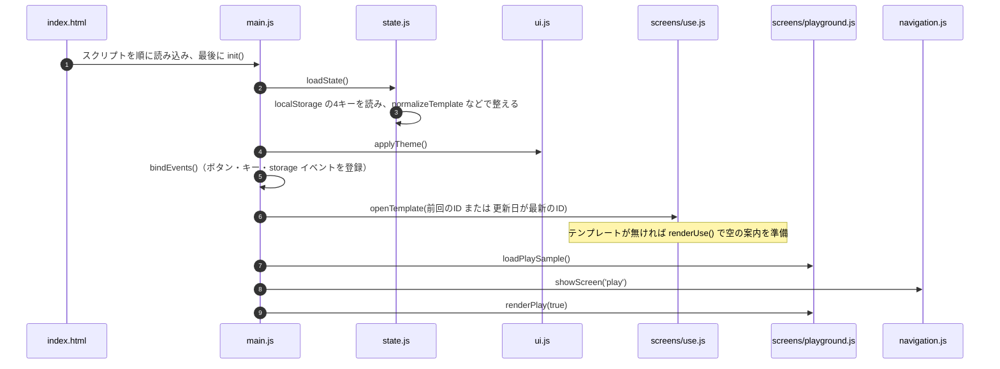
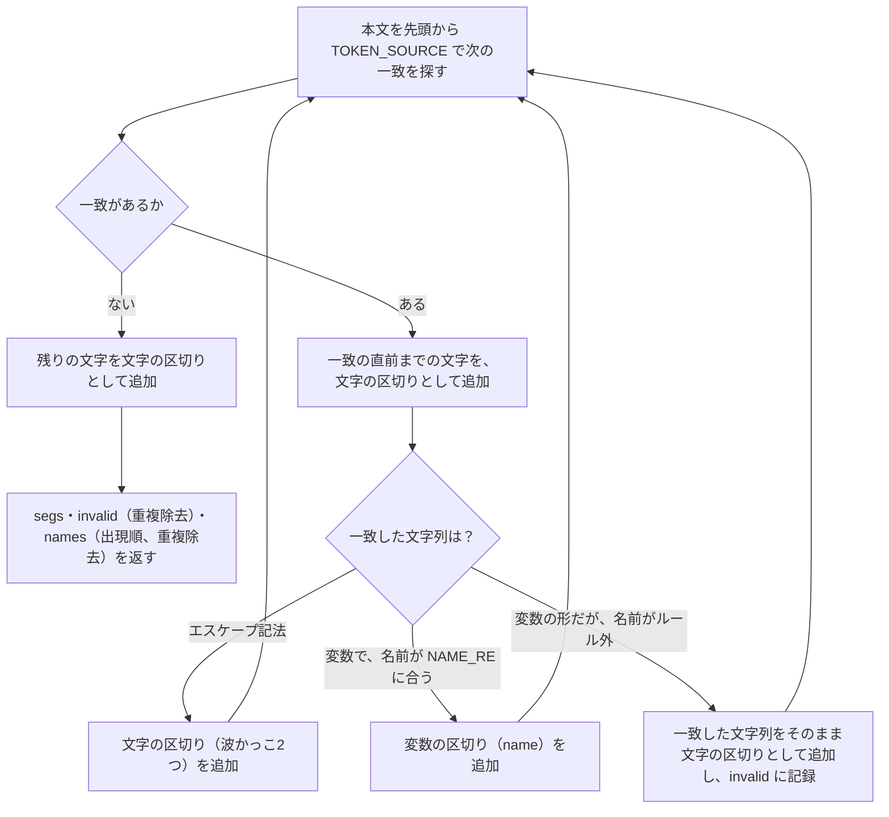
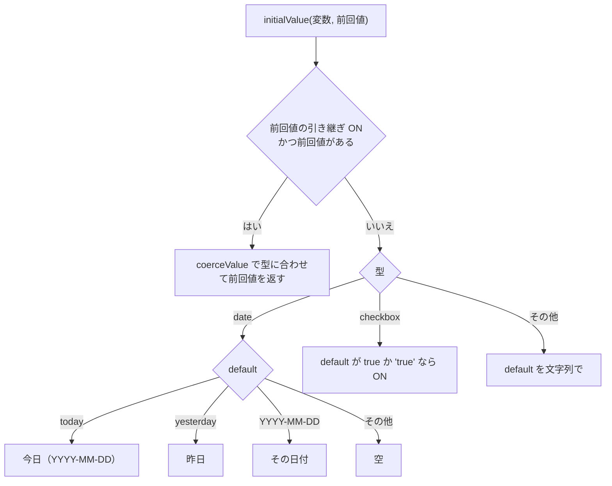
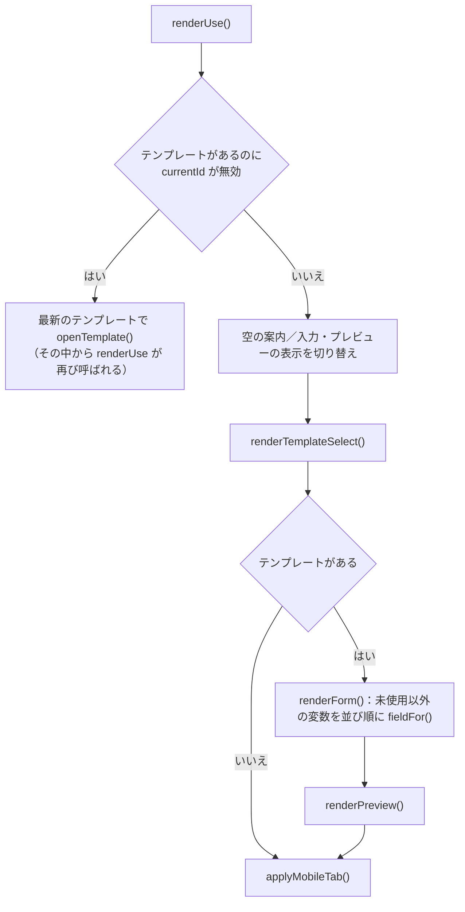
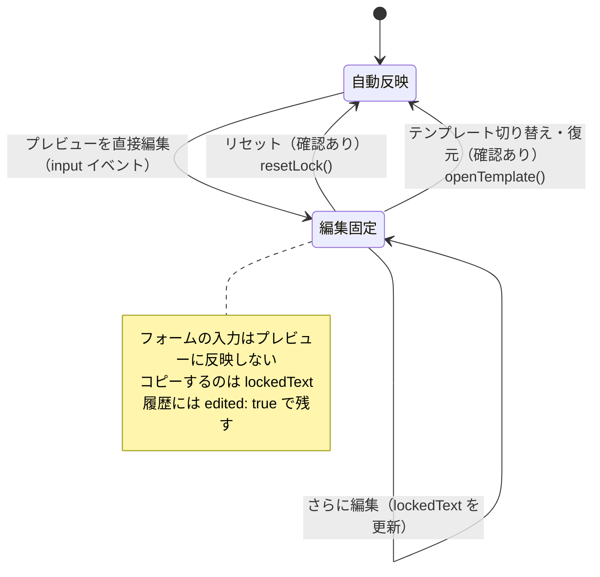
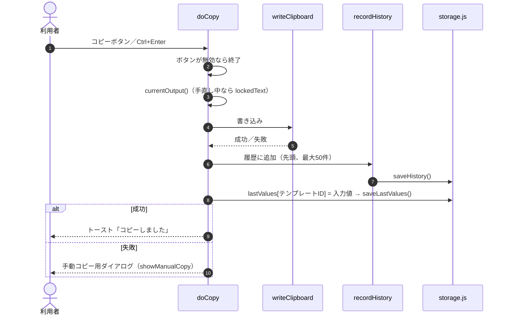
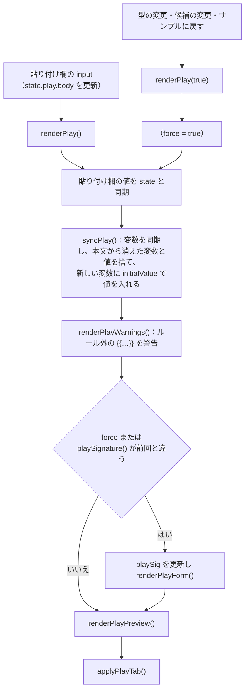
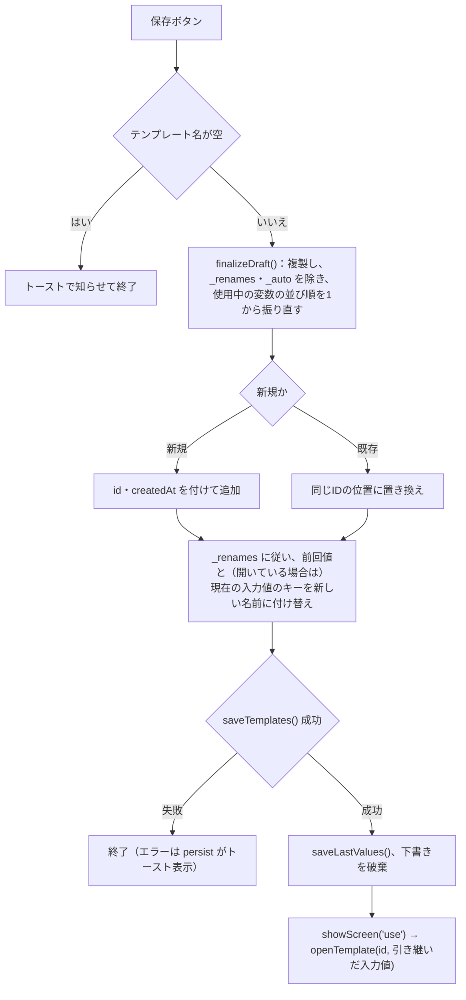
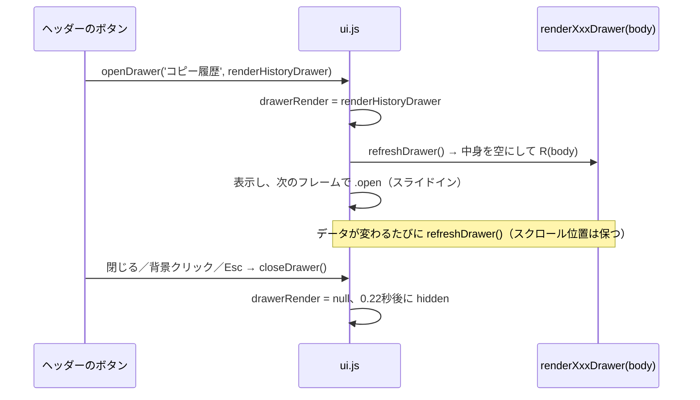
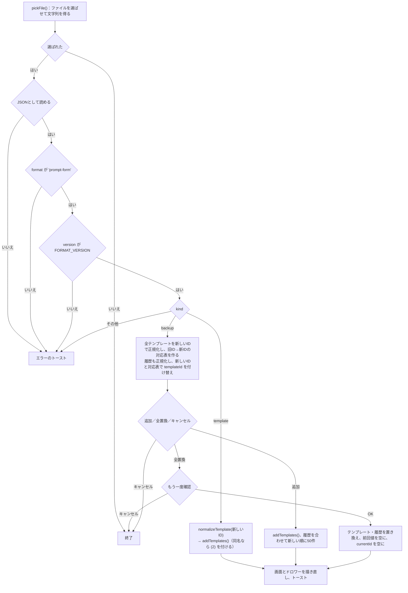

# 可変プロンプトフォーム 詳細設計書（処理の流れ）

作成日：2026-10-12
対象コード：`main` ブランチ

この文書は、主な処理がどの関数をどの順に通るかを説明する。全体の構成は [`basic-design.md`](basic-design.md)、個々の関数の引数・戻り値・呼び出し元は [`function-reference.md`](function-reference.md) を参照。関数名の後ろの（）内はファイル名。

## 目次

1. 起動
2. 本文の解析
3. 変数の同期
4. プロンプトの生成と初期値
5. 利用画面
6. コピーとコピー履歴
7. プレイグラウンド
8. 編集画面
9. 画面の切り替え
10. 共通UI（DOM生成・トースト・ダイアログ）
11. ドロワー
12. バックアップ（書き出し・読み込み）
13. 保存と容量
14. 別タブとの同期
15. テーマ・キーボード・離脱確認
16. CSS の構成
17. 改修ガイド

---

## 1. 起動

`index.html` が15個のスクリプトを順に読み込み、最後の `main.js` が `init()` を実行する。

- 利用画面（マイテンプレート）も裏で描画しておき、タブを切り替えたらすぐ使えるようにしている
- 最後に `window.PromptForm` へ純粋関数（`parseBody`・`generate` など）を公開する。ブラウザのコンソールから動作確認するためのもので、画面からは使わない

## 2. 本文の解析（`parseBody`／template.js）

本文から変数を見つけ、本文を「文字の区切り」と「変数の区切り」の配列（セグメント）に分ける。すべての処理の土台になる関数。

### 2.1 使う正規表現

| 定数 | 値 | 意味 |
| --- | --- | --- |
| `TOKEN_SOURCE` | `\\\{\{` または `\{\{([^{}\n]*?)\}\}` | `\{{`（エスケープ）か、`{{` と `}}` の間に波かっこ・改行を含まない文字列 |
| `NAME_RE` | `^[\p{L}\p{N}_]+$`（`u` フラグ） | 変数名に使える文字（日本語を含む文字・数字・`_`） |

### 2.2 処理

例：本文 `{{相手}}さん、\{{例}} と {{bad name}}` の結果

| 区切り | 内容 |
| --- | --- |
| `{ t: 'var', name: '相手' }` | 変数 |
| `{ t: 'text', v: 'さん、' }` | 文字 |
| `{ t: 'text', v: '{{' }` | エスケープした `{{` |
| `{ t: 'text', v: '例}} と ' }` | 文字 |
| `{ t: 'text', v: '{{bad name}}' }` | ルール外（`invalid` にも入る） |

`names` は `['相手']`、`invalid` は `['{{bad name}}']`。

## 3. 変数の同期（`syncVariables`／template.js）

本文（`t.body`）と変数設定（`t.variables`）を一致させる。テンプレート・下書き・プレイグラウンドのいずれにも使う（引数 `t` は `body` と `variables` を持つオブジェクトなら何でもよい）。`t` を直接書き換える。

1. `parseBody(t.body).names` で、本文に出てくる変数名を得る
2. 設定にない名前は `newVar(name, 最大の order + 1)` で追加し、`_auto = true`（自動で追加した印）を付ける
3. 本文から消えた変数のうち、`_auto` で、かつ設定を何も変えていない（`isPristine`）ものは取り除く（打ちかけの名前を残さないため。rrd 8.3）
4. 残った変数に `unused`（本文に無いか）を付け直す

`_auto` は編集中だけ意味を持つ一時的な印で、保存前（`finalizeDraft`）と読み込み時（`normalizeTemplate`）に消す。プレイグラウンド（`syncPlay`）は、同期のあと `unused` の変数を残さず取り除く。

## 4. プロンプトの生成と初期値

### 4.1 生成（`generate`・`varText`・`isFilled`・`segsToText`／template.js）

`generate(t, values)` は `parseBody` の区切りを順に見て、変数の区切りを入力値で置き換えた区切りの配列を返す。

| 区切り | 出力 |
| --- | --- |
| 文字 | そのまま |
| 変数（入力あり） | `{ t: 'var', name, v: varText(変数, 値), filled: true }` |
| 変数（未入力） | `{ t: 'var', name, v: '{{名前}}', filled: false }` |

`varText(v, raw)` は型ごとに差し込む文字を決める。

| 型 | 差し込む文字 |
| --- | --- |
| `date` | `formatDate(値, options.format)`。トークン `YYYY` `MM` `M` `DD` `D` `ddd`（曜日） |
| `checkbox` | ON なら `options.onText`、OFF なら `options.offText` |
| その他 | 値をそのまま文字列に |

`isFilled(v, raw)` はチェックボックスなら常に「入力あり」、それ以外は `varText` の結果が空白だけでなければ「入力あり」。変数設定が見つからない変数（通常は起きない）は `newVar` の既定値（1行テキスト）として扱う。

画面に出すときは区切りごとに要素を作り（未入力は `<mark class="unfilled">`）、コピーするときは `segsToText` で `v` を連結する。

### 4.2 初期値（`initialValue`・`coerceValue`／template.js）

利用画面でテンプレートを開いたとき、プレイグラウンドで変数が増えたときに、入力欄の最初の値を決める。

`coerceValue` は、チェックボックスなら真偽値に、それ以外は文字列にそろえる（履歴やJSONから戻した値の型を整えるため）。

## 5. 利用画面（screens/use.js）

### 5.1 テンプレートを開く（`openTemplate(id, values)`）

1. `state.currentId` と `state.settings.lastTemplateId` を更新し、設定を保存
2. 編集固定モードを解除（`locked = false`）
3. 各変数の値を決める。引数 `values` に値があればそれを `coerceValue` で使い（履歴からの復元・別タブ同期・保存直後）、無ければ `initialValue(変数, 前回値)`
4. `renderUse()` で描き直す

### 5.2 描画（`renderUse` → `renderForm`・`renderPreview`）

`fieldFor(v, id, ctx)` は変数1つ分の入力欄（見出し・入力部品・説明文）を作る。入力部品は型ごとに異なる。

| 型 | 部品 | 補足 |
| --- | --- | --- |
| `text` | `<input type="text">` | プレースホルダーあり |
| `textarea` | `<textarea rows="3">` | |
| `number` | `<input type="number">` | `options.min`・`max` を属性に |
| `date` | `<input type="date">` ＋「昨日」「今日」ボタン | |
| `select` | `<select>` | 先頭に「選択してください」（空）を付ける |
| `checkbox` | `<label><input type="checkbox">表示名</label>` | |

入力のたびに `state.values[変数名]` を更新して `renderPreview()` を呼ぶ。フォーム自体は作り直さないので、入力中のフォーカスは保たれる。`ctx` を渡すと値の置き場所と更新処理を差し替えられる（プレイグラウンドで使用。7.2）。

### 5.3 プレビューと状態表示（`renderPreview`・`updateMeta`）

- `renderPreview()`：編集固定モードでなければ `generate` の結果で `#preview` を作り直す。最後に `updateMeta()`
- `updateMeta()`：文字数、編集中バッジ、リセットボタン、説明文を更新し、必須の未入力（`requiredMissing`）を調べる。未入力の欄に `.missing` を付け、コピーボタンを無効にし、未入力の項目名を表示する。編集固定モード中は必須チェックをしない

### 5.4 編集固定モード（F-35・F-36）

- プレビュー `#preview` は `contenteditable="plaintext-only"`。対応していないブラウザでは `"true"` にして、貼り付けを `text/plain` だけに制限する（`bindEvents`）
- 手直し中の内容は `preview.innerText` を `state.lockedText` に写して持つ

### 5.5 テンプレートの切り替え（`switchTemplate(id)`）

同じIDなら何もしない（`true` を返す）。編集固定モード中なら確認し、キャンセルされたら選択欄を元に戻して `false` を返す。確認が通れば `openTemplate(id)`。

## 6. コピーとコピー履歴

### 6.1 利用画面のコピー（`doCopy`／screens/use.js）

- 自動コピーに失敗しても、手動でコピーする前提で履歴と前回値は記録する
- `writeClipboard(text)` は、安全なコンテキスト（https・localhost）なら Clipboard API、使えなければ画面外の `<textarea>` を選択して `execCommand('copy')`。どちらも失敗したら `false`

### 6.2 コピー履歴（drawers/history.js）

`recordHistory(t, text)` は `{ id, templateId, templateName, values, output, edited, copiedAt }` を先頭に追加し、50件を超えた分を捨てて保存する。履歴ドロワーが開いていれば描き直す。

ドロワーでは、各履歴に次の操作がある。

| 操作 | 処理 |
| --- | --- |
| 再コピー | `writeClipboard(item.output)`。履歴は増やさない |
| 入力値を復元 | `restoreValues(item)`：手直し中なら確認 → `goScreen('use')` → `openTemplate(item.templateId, item.values)` → 入力タブを表示。テンプレートが削除済みならボタンを無効にする |
| 削除／すべて削除 | 配列から除いて保存（すべて削除は確認あり） |

## 7. プレイグラウンド（screens/playground.js）

### 7.1 データ

`state.play = { body, variables, values }`。テンプレートと同じ形の `body`・`variables` を持つので、`syncVariables`・`generate`・`fieldFor` をそのまま使える。localStorage には保存しない。

`loadPlaySample()` は本文を `PLAY_SAMPLE_BODY`、変数を `playSampleVariables()`（型・初期値付き）にし、`initialValue` で入力値を作り、`playSig` を空にする（次の描画でフォームを必ず作り直すため）。

### 7.2 描画（`renderPlay(force)`）

- `playSignature()` は変数の「名前:型」を並び順に連結した文字列。本文を打っても変数の構成が変わらなければフォームを作り直さないので、入力欄の値やフォーカスが保たれる
- `renderPlayForm()` は各変数に `fieldFor(v, 'p' + 番号, ctx)` を使う。`ctx` は次のとおり

| `ctx` のキー | 値 | 役割 |
| --- | --- | --- |
| `values` | `state.play.values` | 値の置き場所 |
| `onChange` | `renderPlayPreview` | 入力時はプレビューだけ更新 |
| `head` | 型の `<select class="type-select">` | 見出しの右に置く部品 |
| `extra` | `playExtra(v)` | 選択肢の候補・チェックボックスのON文の入力欄 |

- `renderPlayPreview()` は、本文が空なら案内文を出し、そうでなければ `generate` の結果を表示する。未入力の変数名を（重複を除いて）表示し、本文が空ならコピー・保存ボタンを無効にする。必須の概念はないので、未入力でもコピーできる

### 7.3 型の切り替え（`changePlayType(v, type)`）

切り替え前に入力していた文字を、できるだけ新しい型に引き継ぐ。日付・チェックボックスからの切り替えでは引き継がない。引き継ぐのは「値」で、`default`（テンプレート保存時に残る設定）にはしない（F-66）。

| 新しい型 | 設定（`default`・`options`） | 値 |
| --- | --- | --- |
| `text`・`textarea` | なし | 前の文字 |
| `select` | `choices` = 前の文字があれば `[前の文字]`、無ければ `[]` | 前の文字 |
| `number` | なし | 前の文字が数値ならそれ、そうでなければ空 |
| `date` | `default: 'today'`、`format: DEFAULT_DATE_FORMAT` | 今日 |
| `checkbox` | `default: true`、`onText` = 前の文字（無ければ変数名）、`offText: ''` | ON |

最後に `renderPlay(true)` でフォームを作り直す。

選択肢の候補を変えたとき（`playExtra` の `change`）は、今の値が候補に無ければ先頭の候補にしてから `renderPlay(true)`。チェックボックスのON文は入力のたびに `renderPlayPreview()` だけ呼ぶ。

### 7.4 コピー・テンプレートとして保存

- `doPlayCopy()`：`segsToText(playOutputSegs())` をコピーする。**履歴・前回値には記録しない**（F-65）
- `saveFromPlay()`：`syncPlay()` のあと、変数を複製して並び順を1から振り直し、`openEditor(null, { body, variables })` で編集画面を開く（8.1）。編集画面では未保存扱い（`draftDirty = true`）になり、名前を付けて保存すると利用画面に移る。キャンセルするとプレイグラウンドに戻る（入力内容は残っている）

## 8. 編集画面（screens/edit.js）

### 8.1 開く（`openEditor(id, preset)`）

1. `state.draft` を作る。既存テンプレートなら複製、新規なら空。新規で `preset` があれば本文と変数をそれにする
2. `draft._renames = {}`（変数名の変更を記録。8.5）
3. `draftDirty` は「新規かつ `preset` あり」のときだけ `true`
4. 編集画面以外から開いたときは、今の画面を `state.returnTo` に記録
5. `showScreen('edit')` → `renderEditor()`。新規ならテンプレート名の欄にフォーカス

### 8.2 描画と本文の入力（`renderEditor`）

`renderEditor()` は `#editScreen` の中身を毎回作る。上部のバー（戻る・テンプレート名・削除・保存）、左の本文欄、右の入力欄の設定（`#varPanel`）。

本文を入力するたびに次を行う。

1. `draft.body` を更新し `markDirty()`
2. `varSignature`（変数の「名前:未使用か」）を控える
3. `syncVariables(draft)` → `renderWarnings()`（ルール外の `{{…}}` を警告）
4. 変数の構成が変わったときだけ `renderVarPanel()`（設定カードを作り直す）

`renderVarPanel()` は使用中の変数を並び順に、未使用の変数を「未使用の変数」見出しの下に並べる。スクロール位置は保つ。

### 8.3 変数カード（`varCard`）

使用中の変数のカードには次の欄がある。各欄の変更は変数オブジェクトを直接書き換え、`markDirty()` する。

| 欄 | 対象の型 | 作る関数 |
| --- | --- | --- |
| 表示名、型、説明文 | すべて | `varCard` |
| 初期値 | すべて（型ごとに部品が違う） | `defaultEditor` |
| プレースホルダー | `text`・`textarea`・`number` | `varCard` |
| 出力形式／候補／最小値・最大値／ON・OFFの文 | `date`／`select`／`number`／`checkbox` | `typeOptionsEditor` |
| 必須 | `checkbox` 以外 | `varCard` |
| 前回の値を引き継ぐ | すべて | `varCard` |
| ↑↓（並べ替え）、名前変更 | すべて | `moveVar`、`renameVar` |

未使用の変数のカードは名前と「削除」だけを出す。

### 8.4 型の変更（`changeType(v, type)`）

`default` を初期化（チェックボックスは `false`、それ以外は空）し、チェックボックスは必須を外す。日付は出力形式、選択肢は候補の配列を用意する。`options` の他の値は残すので、型を戻せば以前の設定が復活する。

### 8.5 変数名の変更（`renameVar(v)`）

1. `promptDialog` で新しい名前を聞く（`NAME_RE` に合わない、または既にある名前ならエラー）
2. 本文中の `{{旧名}}` を正規表現 `(?<!\\)\{\{旧名\}\}` で `{{新名}}` に置き換える（`\{{旧名}}` のエスケープは置き換えない）
3. `draft._renames[元の名前] = 新名` を記録。同じ変数を何度変えても「保存前の名前 → 最新の名前」の1組になるようにする
4. 本文欄を更新し、同期と再描画

### 8.6 保存（`saveDraft`）

- テンプレート名の重複は保存時には調べない（重複を避ける `uniqueName` は複製・読み込み・サンプル追加のときだけ使う）

### 8.7 キャンセル・削除

- `cancelEdit()`：未保存の変更があれば確認。下書きを破棄し、`state.returnTo` がプレイグラウンドならそこへ、そうでなければ利用画面へ戻る
- `deleteFromEditor()`：`deleteTemplate(id)`（確認あり）が成功したら利用画面へ戻る

## 9. 画面の切り替え（navigation.js）

- `showScreen(name)`：`state.screen` を変え、3つの画面・画面タブ・ヘッダーの各部品の表示を切り替え、`<main>` に `editing`／`playing` クラスを付け外しし、先頭へスクロールする。**描画はしない**
- `goScreen(name)`：同じ画面なら何もしない。`showScreen` のあと、利用画面なら `renderUse()`、プレイグラウンドなら `renderPlay()` で描き直す。タブ・一覧・履歴など、利用者の操作による切り替えはこちらを使う
- 編集画面への切り替えは `openEditor` が、編集画面からの切り替えは `saveDraft`・`cancelEdit`・`deleteFromEditor` が `showScreen` を直接呼ぶ

## 10. 共通UI（utils.js・ui.js）

### 10.1 DOMの生成（`h(tag, props, ...kids)`）

| `props` のキー | 扱い |
| --- | --- |
| 値が `null`・`undefined`・`false` | 無視 |
| `class` | `className` |
| `text` | `textContent`（文字は必ずテキストとして入る） |
| `on` で始まり値が関数 | `addEventListener`（例：`onclick` → `click`） |
| `checked`・`disabled`・`selected`・`readOnly` | プロパティとして設定 |
| `value` | **子要素を追加した後**に設定（`<select>` の選択状態を正しく反映するため） |
| その他 | 属性。値が `true` なら空文字の属性 |

`kids` は配列を平らにして追加し、`null`・`false` は飛ばし、文字列はテキストノードにする。

### 10.2 トーストとダイアログ（ui.js）

| 関数 | 戻り値 | 内容 |
| --- | --- | --- |
| `toast(msg, kind, ms)` | なし | 画面下部に通知。`kind` は `ok`・`error`・`warn` |
| `modal({ title, content, actions, onOpen })` | Promise（押したボタンの `value`。Esc などで閉じたら `null`） | `<dialog id="modal">` に中身を作って開く。ボタンの `validate` が `false` を返すと閉じない |
| `confirmDialog(message, opts)` | Promise\<boolean\> | 確認。`danger` で赤いボタン |
| `promptDialog(title, label, initial, validate, okLabel)` | Promise\<string\|null\> | 1行入力。`validate` はエラー文（問題なければ空文字）を返す。Enter で決定（日本語変換中は除く） |

## 11. ドロワー（ui.js と drawers/*.js）

1つのDOM（`#drawer`）を使い回す。開くときに「中身を描く関数」を変数 `drawerRender` に覚え、データが変わったら `refreshDrawer()` でその関数を呼び直す。

| ドロワー | 描く関数 | 主な操作 |
| --- | --- | --- |
| テンプレート一覧 | `renderListDrawer` | 新規作成、読み込み、サンプル追加、選択（`switchTemplate` → `goScreen('use')`）、編集、複製（`duplicateTemplate`）、書き出し（`exportTemplate`）、削除（`deleteTemplate`） |
| コピー履歴 | `renderHistoryDrawer` | 6.2 参照 |
| 設定 | `renderSettingsDrawer` | テーマ（即時に `saveSettings`・`applyTheme`）、すべて書き出し、読み込み、使用量の表示 |

`deleteTemplate(id)` は確認のあと、テンプレートと前回値を消して保存する。開いていたテンプレートなら `currentId` を空にし、`renderUse()` が最新のテンプレートを開き直す。成否を真偽値で返す。

## 12. バックアップ（drawers/settings.js）

### 12.1 書き出し

`download(ファイル名, オブジェクト)` が整形したJSONを Blob にし、一時的な `<a download>` をクリックして保存させる。

| 関数 | ファイル名 | 中身 |
| --- | --- | --- |
| `exportAll()` | `prompt-form-backup-YYYYMMDD.json` | `{ format, version, kind: 'backup', exportedAt, templates, history }` |
| `exportTemplate(id)` | `template-<名前>.json`（使えない文字は `_` に） | `{ format, version, kind: 'template', exportedAt, template }` |

### 12.2 読み込み（`importFromFile`）

形式チェックで弾いた場合は、データを一切変更しない（F-55）。

## 13. 保存と容量（storage.js）

- `load(key, fallback)`：読めない・壊れているときは `fallback`
- `persist(key, value)`：JSONで書き、`checkQuota()`。例外（容量超過など）ならエラーのトーストを出して `false`
- `save*`：`persist(KEYS.xxx, state.xxx)` の短縮形
- `storageBytes()`：4キーの「キー＋値の文字数 × 2」を合計（UTF-16換算の概算）
- `checkQuota()`：`QUOTA_WARN_BYTES`（4.5MB）を超えたら、1回だけ警告のトースト

## 14. 別タブとの同期

`window` の `storage` イベント（別のタブが localStorage を変えたときに届く）を受けて、次のようにする（`bindEvents`）。

1. 対象が `KEYS` 以外、または編集画面を表示中なら何もしない（編集中の下書きを守る）
2. 開いていたテンプレートID・入力値・編集固定モードかどうかを控えて、`loadState()`
3. 編集固定モードでなければ、同じテンプレートがまだあれば控えた入力値で開き直し、無ければ `currentId` を空にして `renderUse()`。編集固定モード中は画面を触らない
4. `refreshDrawer()`

プレイグラウンドは保存していないので影響を受けない。

## 15. テーマ・キーボード・離脱確認

- テーマ：`applyTheme()` が `settings.theme` に応じて `<html data-theme="light|dark">` を付け外しする。`auto` なら属性を外し、CSSの `prefers-color-scheme` に任せる
- キーボード（`bindEvents` の `keydown`）
  - Esc：ドロワーが開いていてダイアログが開いていなければ閉じる
  - Ctrl/⌘ + Enter：編集画面以外で、ダイアログ・ドロワーが開いていなければ、プレイグラウンドなら `doPlayCopy()`、利用画面なら `doCopy()`
- 離脱確認：編集画面で未保存の変更があるとき、`beforeunload` でブラウザの確認を出す

## 16. CSS の構成（css/style.css）

| 区分 | 内容 |
| --- | --- |
| デザイントークン | `:root` に色・影・等幅フォントを変数で定義。ダークは `@media (prefers-color-scheme: dark)` の `:root:not([data-theme="light"])` と `:root[data-theme="dark"]` で同じ変数を上書き |
| 基本要素 | ボタン（`.primary`・`.ghost`・`.danger`・`.danger-ghost`・`.small`）、入力欄、チェックボックス |
| 共通部品 | `.app-header`、`.panel`、`.badge`、`.preview`（`.locked`）、`mark.unfilled`、`.warn-box` |
| 画面ごと | 利用画面（`.use-grid`・`.field`・`.missing`）、画面タブ（`.screen-tabs`）、プレイグラウンド（`.play-grid`・`.type-select`・`.field-extra`）、編集画面（`.edit-grid`・`.var-card`） |
| 重ねて出すもの | ドロワー（`.drawer`・`.open`）、ダイアログ（`dialog`）、トースト（`.toast`） |
| レスポンシブ | 768〜1023px（プレイグラウンドを2段に）、767px以下（1列・タブ切り替え・コピーボタン固定） |

画面の配置は CSS Grid の `grid-template-areas` で行う。スマートフォンでは、JSがグリッドに付ける `tab-form`・`tab-preview`・`tab-src` クラスに応じて、表示しないパネルを `display: none` にする。

## 17. 改修ガイド

よくある改修で手を入れる箇所。改修したら、設計書（この文書・基本設計書・関数一覧）と、必要なら要件定義書も更新する。

### 17.1 入力欄の型を追加する

| ファイル | 箇所 |
| --- | --- |
| `js/constants.js` | `TYPES` に `[キー, 表示名]` を追加 |
| `js/template.js` | `varText`（差し込む文字）、`isFilled`、`initialValue`、`coerceValue`、`normalizeVar`（`default` の型） |
| `js/screens/use.js` | `fieldFor`（入力部品） |
| `js/screens/edit.js` | `changeType`、`defaultEditor`、`typeOptionsEditor`、`varCard`（プレースホルダー・必須を出すかの条件） |
| `js/screens/playground.js` | `changePlayType`、必要なら `playExtra` |
| `docs/rrd.md` | 3.3、5.2 |

### 17.2 保存データに項目を足す

- 該当する正規化関数（`normalizeTemplate`・`normalizeVar`・`normalizeHistoryItem`）で、古いデータに項目が無い場合の既定値を決める
- 書き出しファイルの互換性が崩れる場合は `FORMAT_VERSION` を上げ、`importFromFile` で古いバージョンの扱いを決める
- `docs/rrd.md` 5章を更新

### 17.3 画面を足す

1. `index.html` に `<section id="xxxScreen" hidden>` を追加
2. `showScreen` に表示の切り替えを、`goScreen` に描画関数の呼び出しを追加
3. 必要なら `#screenTabs` にタブを追加し、`state.screen` の取りうる値を設計書に追記
4. `js/screens/xxx.js` を作り、`index.html` の `screens/` の並びに `<script>` を追加

### 17.4 ドロワーを足す

1. `js/drawers/xxx.js` に `renderXxxDrawer(body)` を作る（`body` に要素を追加するだけ）
2. ヘッダーにボタンを足し、`bindEvents` で `openDrawer('タイトル', renderXxxDrawer)` を登録
3. データを変えたら `refreshDrawer()` を呼ぶ

### 17.5 ファイルを足す・名前を変える

`index.html` の `<script>` の並び、基本設計書 3章・4章、関数一覧、README の構成表を更新する。トップレベルの名前はすべてのファイルで共有されるので、既存の名前と重ならないようにする。
